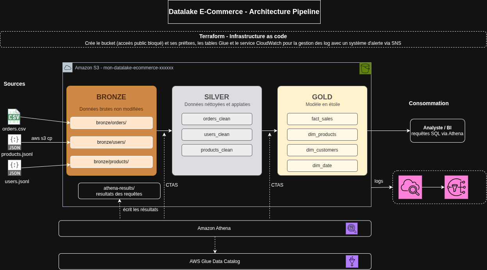

# Datalake e-commerce sur AWS (S3 · Glue Data Catalog · Athena)

Pipeline de données en architecture **médaillon (bronze → silver → gold)** construit uniquement avec **Amazon S3**, **AWS Glue Data Catalog** et **Amazon Athena**, et déployé avec **Terraform**.

À partir de trois fichiers sources (commandes, produits, clients), le projet produit un modèle en étoile prêt pour l'analyse : chiffre d'affaires par pays, par période, analyse des clés orphelines, etc.

> Le détail des schémas est dans [`architecture.md`](architecture.md).

---

## Sommaire

1. [Objectifs et contraintes](#1-objectifs-et-contraintes)
2. [Sources de données](#2-sources-de-données)
3. [Architecture](#3-architecture)
4. [Organisation du bucket S3](#4-organisation-du-bucket-s3)
5. [Couche bronze](#5-couche-bronze)
6. [Couche silver](#6-couche-silver)
7. [Couche gold](#7-couche-gold)
8. [Qualité des données : constats et traitements](#8-qualité-des-données--constats-et-traitements)
9. [Questions métier](#9-questions-métier)
10. [Déploiement et exécution](#10-déploiement-et-exécution)
11. [Choix de conception](#11-choix-de-conception)
12. [Limites connues et pistes d'amélioration](#12-limites-connues-et-pistes-damélioration)

---

## 1. Objectifs et contraintes

**Objectifs**

- Ingérer trois sources hétérogènes (un CSV, deux fichiers JSON Lines) sans les modifier (bronze).
- Les nettoyer, les typer et les aplatir (silver).
- Produire un modèle en étoile pour répondre à des questions métier (gold).
- Décrire l'infrastructure sous forme de code (Terraform).

**Contraintes**

- Services de données autorisés : **S3, Glue Data Catalog, Athena** uniquement. Pas de job Glue ETL, de Lambda, d'EMR ni de Step Functions.
- Toute transformation est une requête SQL Athena (`CREATE TABLE AS SELECT`).

---

## 2. Sources de données

| Fichier | Format | Contenu | Remarques |
|---|---|---|---|
| `orders.csv` | CSV avec en-tête | Lignes de commande : `InvoiceNo`, `ProductID`, `Quantity`, `InvoiceDate`, `UnitPrice`, `CustomerID`, `Country` | 7 956 lignes ; du 14/04/2026 au 13/07/2026 ; 261 produits et 210 clients distincts |
| `products.jsonl` | JSON Lines | Catalogue produit : `id`, `title`, `category`, `brand`, `price`, `discountPercentage`, `stock`, `tags` (tableau), `dimensions` (objet imbriqué), etc. | Structures imbriquées |
| `users.jsonl` | JSON Lines | Clients : `id`, `firstName`, `lastName`, `email`, `address` (objet imbriqué), `company` (objet imbriqué), etc. | Clés en camelCase ; objets imbriqués sur deux niveaux |

Une **ligne** d'`orders.csv` est une **ligne de facture**, pas une commande : une facture (`InvoiceNo`) contient plusieurs lignes, une par produit.

---

## 3. Architecture



  Stockage : S3  ·  Métadonnées : Glue Data Catalog  ·  Requêtes : Athena
---

## 4. Organisation du bucket S3

Un seul bucket, nommé `<mon-datalake-ecommerce>-<suffixe aléatoire>` avec un préfixe par couche :

```
s3://<bucket>/
├── bronze/
│   ├── orders/
        ├── ingest_date=<date_courante>/   # orders.csv
│   ├── products/
        ├── ingest_date=<date_courante>/  # products.jsonl
│   └── users/ 
        ├── ingest_date=<date_courante>/  # users.jsonl
├── silver/
│   ├── orders/          # orders_clean (Parquet)
│   ├── products/        # products_clean (Parquet)
│   └── users/           # users_clean (Parquet)
├── gold/
│   ├── dim_products/
│   ├── dim_customers/
│   ├── dim_date/
│   └── fact_sales/
└── athena-results/      # résultats des requêtes Athena
```

Le bucket bloque tout accès public (`aws_s3_bucket_public_access_block`). La base Glue porte le même nom que le projet, avec des underscores (`mon_datalake_ecommerce_xxxxxx`).

---

## 5. Couche bronze

**Principe : Les données sont stocker tel quel, pour les rendre interrogeable.** Aucun nettoyage, aucune conversion de type (toutes les colonnes sont de type string), aucune déduplication.

| Table | Format de lecture (SerDe) | Particularités |
|---|---|---|
| `orders` | `OpenCSVSerde` | En-tête ignoré (`skip.header.line.count = 1`) ; **toutes les colonnes en `string`** |
| `products` | `JsonSerDe` (`org.openx.data.jsonserde.JsonSerDe`) | `case.insensitive = true`, `ignore.malformed.json = true` ; structures imbriquées en `struct`, `tags` en `array<string>` |
| `users` | `JsonSerDe` | Idem ; `address` et `company` en `struct` imbriqués |

Points d'attention :

- Les colonnes sont en minuscules dans le catalogue Hive/Glue (`firstName` devient `firstname`) ; `case.insensitive = true` permet la correspondance avec les clés JSON en camelCase.
- Les formats d'entrée et de sortie Hadoop doivent être renseignés (`TextInputFormat`, `HiveIgnoreKeyTextOutputFormat`), sinon Athena renvoie `HIVE_UNSUPPORTED_FORMAT`.
- Le nom de la classe est sensible à la casse : `JsonSerDe`, et non `JsonSerde` (erreur `HIVE_SERDE_NOT_FOUND`).

---

## 6. Couche silver

**Principe : données propres, typées et aplaties**, en Parquet compressé (Snappy). Les tables sont créées par CTAS.

### `users_clean`

`customer_id`, `firstname`, `lastname`, `email`, `city`, `country`, `company_name` — les champs imbriqués (`address.city`, `address.country`, `company.name`) sont aplatis.

### `products_clean`

`product_id`, `title`, `category`, `brand`, `catalog_price`, `discounted_price`, `stock`, `width`, `height`, `depth`.

- `discounted_price = round(price − price × discountpercentage / 100, 2)`
- `dimensions` est aplati en `width`, `height`, `depth`.

### `orders_clean`

| Colonne | Règle |
|---|---|
| `invoiceno` | Conservé en **string** (car les factures `C…` sont des annulations) |
| `product_id`, `customer_id` | `TRY_CAST(... AS BIGINT)` ; une valeur vide devient `NULL` |
| `quantity` | `TRY_CAST(... AS INT)` |
| `unit_price` | `TRY_CAST(... AS DECIMAL(10,2))` |
| `line_amount` | `unit_price × quantity` (négatif pour un retour) |
| `country` | Standardisé : variantes et fautes (`USA`, `U.K.`, `FRNACE`) et noms français (`ITALIE`, `ESPAGNE`, `SUISSE`, `ALLEMAGNE`, `PAYS-BAS`, `BELGIQUE`) ramenés à un nom anglais ; casse normalisée |
| `is_return` | `TRUE` si `invoiceno` commence par `C` |
| `invoice_date` | `TRY_CAST(... AS TIMESTAMP)` |

**Règles d'exclusion** de `orders_clean` : numéro de facture absent, quantité non convertible en entier, date de facture non convertible.

**Volumétrie mesurée dans Athena** : 7 956 lignes en bronze, **7 463 lignes** dans `orders_clean` (voir le point « Écart bronze / silver » dans les [limites](#12-limites-connues-et-pistes-damélioration)).

`TRY_CAST` est utilisé partout : un `CAST` strict ferait échouer toute la requête sur une seule valeur vide (`INVALID_CAST_ARGUMENT`).

---

## 7. Couche gold

**Modèle en étoile**:

| Table | Rôle |
|---|---|
| `fact_sales` | Table de faits ; **une ligne par ligne de facture** |
| `dim_products` | Dimension produit |
| `dim_customers` | Dimension client |
| `dim_date` | Dimension date (jours de 2026, générée par `sequence()`) |

### Clés orphelines :

Chaque dimension contient une ligne de clé **`-1`** (« Unknown »). Une commande dont le produit, le client ou la date n'existe pas dans la dimension correspondante est **rattachée à `-1`**, et non exclue :

```sql
LEFT JOIN products_clean p ON o.product_id  = p.product_id
LEFT JOIN users_clean    u ON o.customer_id = u.customer_id
LEFT JOIN dim_date       d ON CAST(o.invoice_date AS DATE) = d.full_date
-- COALESCE(p.product_id, -1), COALESCE(u.customer_id, -1), COALESCE(d.date_key, -1)
```

Des indicateurs conservent la cause : `product_orphan`, `customer_orphan`, `date_orphan`, `is_guest_order` (client absent de la commande, c'est-à-dire un achat sans identifiant client).

**Pourquoi ne pas exclure ?** Ce sont de vraies ventes : les exclure rendrait le CA de gold inférieur à celui de silver. Le rattachement à `-1` garde les totaux réconciliés et permet de quantifier le problème.

---

## 8. Qualité des données : constats et traitements

Constats observés dans `orders.csv`, et traitement retenu :

| Constat | Ampleur | Traitement |
|---|---|---|
| Factures `C…` (annulations/retours) avec quantités négatives | 243 lignes `C…`, 240 quantités négatives | `invoiceno` en texte, indicateur `is_return`, montants négatifs conservés (CA net) |
| Quantité vide | 116 lignes | Exclue de silver (le montant ne peut pas être calculé) |
| Date de facture vide ou invalide | 65 lignes | Exclue de silver (la date est nécessaire à l'analyse temporelle) |
| `CustomerID` vide | 157 lignes | Conservé (`customer_id` à `NULL`) ; rattaché à `-1` en gold avec `is_guest_order` |
| Variantes de pays (fautes, noms français, casse) | Plusieurs variantes | Standardisation par `CASE` en silver |
| Identifiants produit/client hors catalogue | `ProductID` et `CustomerID` jusqu'à 9 992 | Clé orpheline rattachée à `-1` en gold |
| Prix unitaires négatifs | 29 lignes | **Non exclus actuellement** (voir [limites](#12-limites-connues-et-pistes-damélioration)) |
| Prix unitaires nuls | 45 lignes | Conservés |
| Prix des commandes sans lien avec le prix catalogue | Prix de 0 à 250 quel que soit le produit | Deux colonnes distinctes : `unit_price` (commande) et `catalog_price` (catalogue) |
| Dates différentes pour une même facture | 1 832 factures sur 2 226 | Date conservée par ligne ; ne pas supposer « une facture = une date » |
| Lignes exactement dupliquées | 156 lignes | Voir [limites](#12-limites-connues-et-pistes-damélioration) |
| Même couple (facture, produit) répété, parfois avec des prix différents | 237 couples | Voir [limites](#12-limites-connues-et-pistes-damélioration) |

Plusieurs de ces constats (prix indépendants du catalogue, dates dispersées sur une facture) indiquent que `orders.csv` est un jeu de données **synthétique** : les chiffres sont utiles pour la démonstration, pas comme vérité métier.

---

## 9. Questions métier

### Combien de lignes référencent un produit ou un client absent du catalogue, et quel CA cela représente-t-il ?

```sql
SELECT
  COUNT(*)                                                          AS total_lignes,
  SUM(line_amount)                                                  AS ca_total,
  COUNT_IF(product_orphan)                                          AS lignes_produit_orphelin,
  SUM(line_amount) FILTER (WHERE product_orphan)                    AS ca_produit_orphelin,
  COUNT_IF(customer_orphan)                                         AS lignes_client_orphelin,
  SUM(line_amount) FILTER (WHERE customer_orphan)                   AS ca_client_orphelin,
  COUNT_IF(is_guest_order)                                          AS lignes_sans_client,
  COUNT_IF(product_orphan OR customer_orphan)                       AS lignes_orphelines_total,
  SUM(line_amount) FILTER (WHERE product_orphan OR customer_orphan) AS ca_orphelin_total
FROM fact_sales;
```

Traitement : ces lignes sont **rattachées à la clé « inconnu » (`-1`)**, ni exclues ni isolées dans une table séparée.

### Chiffre d'affaires total et par pays sur les 3 derniers mois

Les données couvrent du 14/04/2026 au 13/07/2026. La fenêtre est donc calculée **à partir de la date la plus récente des données**, et non de la date du jour (une fenêtre basée sur `CURRENT_DATE` serait vide).

```sql
WITH bornes AS (
  SELECT MAX(CAST(invoice_date AS DATE)) AS date_max FROM fact_sales
)
SELECT
  COALESCE(f.order_country, 'TOTAL')                          AS pays,
  ROUND(SUM(f.line_amount), 2)                                AS ca_net,
  ROUND(SUM(f.line_amount) FILTER (WHERE NOT f.is_return), 2) AS ca_brut,
  ROUND(SUM(f.line_amount) FILTER (WHERE f.is_return), 2)     AS retours
FROM fact_sales f
CROSS JOIN bornes b
WHERE CAST(f.invoice_date AS DATE) > date_add('month', -3, b.date_max)
GROUP BY ROLLUP (f.order_country)
ORDER BY ca_net DESC;
```

- **CA net** : toutes les lignes, retours inclus (valeurs négatives).
- **CA brut** : hors retours.
- La ligne `TOTAL` est le total général (`ROLLUP`).

---

## 10. Déploiement et exécution

### Prérequis

- Compte AWS et AWS CLI configuré
- Terraform 1.5 ou supérieur
- Les trois fichiers sources

### Étapes

**1. Déployer l'infrastructure**

```bash
terraform init
terraform apply
```

Terraform crée le bucket (accès public bloqué), les préfixes, la base Glue et les tables bronze. Il configure aussi l'emplacement des résultats Athena (`athena-results/`) sur le workgroup `primary` existant : celui-ci est importé dans l'état Terraform avec un bloc `import` (Terraform 1.5 ou supérieur) plutôt que recréé.

**2. Déposer les fichiers sources**

```bash
aws s3 cp orders.csv    s3://<bucket>/bronze/orders/
aws s3 cp products.jsonl s3://<bucket>/bronze/products/
aws s3 cp users.jsonl   s3://<bucket>/bronze/users/
```

**3. Contrôler le bronze** (console Athena, workgroup `primary`, base du projet)

```sql
SELECT COUNT(*) FROM orders;   -- 7 956 attendu
```

**4. Construire silver puis gold, une requête par exécution, dans cet ordre**

1. `users_clean`, `products_clean`, `orders_clean`
2. `dim_products`, `dim_customers`, `dim_date`
3. `fact_sales`

**5. Contrôler**

```sql
-- Comptages par couche
SELECT 'orders (bronze)' AS couche, COUNT(*) AS n FROM orders
UNION ALL SELECT 'orders_clean', COUNT(*) FROM orders_clean
UNION ALL SELECT 'fact_sales',   COUNT(*) FROM fact_sales
UNION ALL SELECT 'dim_date',     COUNT(*) FROM dim_date;

-- Réconciliation silver / gold : les deux totaux doivent être égaux
SELECT (SELECT SUM(line_amount) FROM orders_clean) AS total_silver,
       (SELECT SUM(line_amount) FROM fact_sales)   AS total_gold;

-- Les clés de dimension doivent être uniques (sinon les jointures dupliquent des lignes)
SELECT COUNT(*) - COUNT(DISTINCT product_id)  FROM products_clean;
SELECT COUNT(*) - COUNT(DISTINCT customer_id) FROM users_clean;
```

### Reconstruire une table

Un CTAS échoue si la table existe ou si son emplacement S3 n'est pas vide :

1. `DROP TABLE IF EXISTS <table>;`
2. Vider le préfixe S3 correspondant (`aws s3 rm s3://<bucket>/<préfixe>/ --recursive`)
3. Relancer le `CREATE TABLE ... AS SELECT`

Athena n'accepte qu'**une instruction par exécution** : `DROP TABLE` et `CREATE TABLE` se lancent séparément. Une requête CTAS en échec laisse des fichiers temporaires sous `athena-results/Unsaved/`, qui peuvent être supprimés.

### Structure recommandée du dépôt

```
.
├── README.md
├── architecture.md
├── terraform/
│   ├── main.tf          # bucket, préfixes, base Glue, tables bronze, workgroup
│   └── variables.tf
└── sql/
    ├── 01_silver_users.sql
    ├── 02_silver_products.sql
    ├── 03_silver_orders.sql
    ├── 04_gold_dim_products.sql
    ├── 05_gold_dim_customers.sql
    ├── 06_gold_dim_date.sql
    ├── 07_gold_fact_sales.sql
    └── 99_controles.sql
```

---

## 11. Choix de conception

- **Médaillon en trois couches** : le bronze garde la source rejouable ; le silver porte les règles de qualité ; le gold porte le modèle métier.
- **Bronze en `string`** : le typage strict est repoussé en silver, où `TRY_CAST` permet de gérer les valeurs invalides au lieu de faire échouer la lecture.
- **Parquet + Snappy** en silver et gold : format colonnaire compressé.
- **Pas de partitionnement** : avec environ 8 000 lignes (moins de 200 Ko), les partitions ralentiraient les requêtes ; de plus, un CTAS Athena est limité à 100 partitions ouvertes.
- **Clé `-1`** plutôt que `NULL` ou exclusion : voir la section [Couche gold](#7-couche-gold).
- **`invoiceno` en texte et `is_return`** : les annulations (`C…`) sont des données valides, pas des erreurs.
- **Deux prix distincts** (`unit_price` de la commande, `catalog_price` du catalogue) : ils ne sont pas comparables dans ces données.
- **SQL séparé de Terraform** : Terraform n'a pas de ressource « exécuter une requête Athena » ; il déploie l'infrastructure, les transformations restent des scripts SQL versionnés.

---

## 12. Limites connues et pistes d'amélioration

- **Prix négatifs.** Les 29 lignes à prix négatif ne sont pas exclues de `orders_clean` ; elles réduisent le CA comme un remboursement alors que leur facture n'est pas une annulation. Piste : les mettre en quarantaine dans une table `orders_rejected` avec un motif (`negative_unit_price`).
- **Doublons.** La requête silver décrite ci-dessus n'applique pas de déduplication. Les doublons exacts peuvent être supprimés sans risque ; une même ligne de facture avec des prix différents doit être signalée ou mise en quarantaine plutôt que tranchée automatiquement.
- **Table de rejets.** Les lignes exclues de silver ne sont pas conservées. Piste : `orders_rejected` avec une colonne `reject_reason`, pour justifier l'écart bronze/silver.
- **Écart bronze / silver.** Appliquées au fichier source, les trois règles d'exclusion écartent 181 lignes (soit 7 775 conservées), alors que `orders_clean` en compte 7 463. Les 312 lignes d'écart doivent être expliquées (une règle supplémentaire ou une déduplication dans la requête réellement exécutée) avant de figer les chiffres du rapport.
- **Dates par facture.** Une facture peut porter plusieurs dates : les indicateurs « nombre de commandes par jour » comptent la même facture plusieurs fois.
- **Orchestration.** Pas de planification : les requêtes sont lancées à la main. Pour un chargement récurrent, passer à `INSERT INTO` et utiliser un ordonnanceur externe.
- **Étendue de `dim_date`.** Limitée à l'année 2026 ; à élargir si les données dépassent cette période.
- **Données personnelles.** `email` est présent en silver mais exclu du modèle gold, qui n'en a pas besoin pour l'analyse des ventes.
